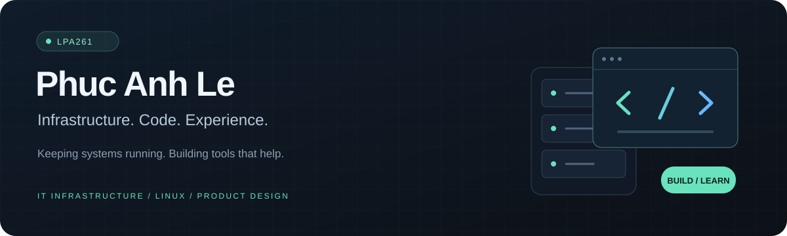

<!-- Profile README for github.com/lpa261. Banner is maintained in this repository. -->

  

  <a href="#about">About</a> &nbsp;·&nbsp;
  <a href="#featured-project">Featured project</a> &nbsp;·&nbsp;
  <a href="#toolkit">Toolkit</a> &nbsp;·&nbsp;
  <a href="#currently-exploring">Exploring</a> &nbsp;·&nbsp;
  <a href="mailto:anhle7666@gmail.com">Contact</a>

## About

Hi, I'm **Phuc Anh** — you can call me **Aaron**. I'm an IT infrastructure professional in Vietnam who enjoys building software and exploring UX design.

My background includes **3 years supporting IT infrastructure across 24 cinema locations**: networks, firewalls, POS systems, office devices, and digital cinema equipment. That work shaped how I approach software: understand the problem, make the workflow clear, and troubleshoot when things go wrong.

These days, I'm bringing that mindset to **Linux desktop tools**, with a growing interest in C, native interfaces, and thoughtful product design.

## Featured project

### [TeraConvert ↗](https://github.com/lpa261/tera-converter)

**File conversion, optimization, and Quick Look — right inside GNOME Files.**

A Linux desktop project that brings everyday file actions into the Nautilus context menu, with a separate viewer for quick previews.

- **Convert** images, audio, video, and supported documents using local processing.
- **Optimize** supported files with validation tailored to each backend.
- **Preview** supported images, text, PDFs, and media through a GTK4 interface.

**Built with:** `C11` · `GLib / GIO` · `GTK4` · `libadwaita` · `Meson`  
**Integrations:** `Nautilus` · `FFmpeg` · `libvips` · `Poppler`

*Actively in development. Format support and available features depend on installed backends.*

[Explore the source →](https://github.com/lpa261/tera-converter) &nbsp; [Read the documentation →](https://github.com/lpa261/tera-converter#readme)

## Toolkit

| Area | Hands-on experience & current tools |
| :--- | :--- |
| **Infrastructure** | LAN/WAN troubleshooting, FortiGate, Cisco & TP-Link switching, network cabling |
| **IT support** | POS systems, PCs, printers, CCTV, preventive maintenance, vendor coordination |
| **Digital cinema** | Christie projection systems, Dolby & QSC audio systems |
| **Current development** | C, GLib/GIO, GTK4, libadwaita, Meson, Git |
| **Design & experiments** | Figma, UX prototyping, Linux desktop workflows, personal homelab |

## Currently exploring

- **Native Linux development** — C, desktop integration, and responsive interfaces.
- **Practical UX** — making frequent actions easier to find and use.
- **Homelab projects** — experimenting with infrastructure and self-hosted services.

---

  <b>Have a useful problem to solve?</b> 
  I'm happy to talk about IT infrastructure, Linux tools, and practical software ideas.  
  <a href="mailto:anhle7666@gmail.com">Email me</a> &nbsp;·&nbsp;
  <a href="https://github.com/lpa261?tab=repositories">Browse my projects</a>

